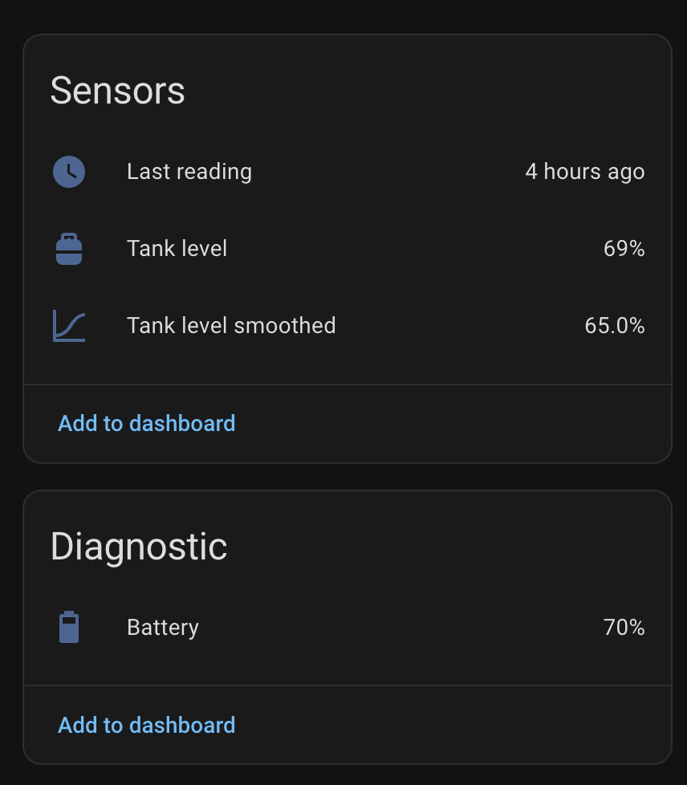

# Levelgas for Home Assistant


Monitor your Levelgas tanks in Home Assistant.

- Tank level, battery percentage, and last reading timestamp.
- Smoothed tank level using a rolling median to reduce isolated sensor spikes.
- Configurable polling, smoothing window, and sensor timezone.
- History and long-term statistics for tank levels.
- Persistent smoothing across restarts and integration updates.
- Credentials and sessions stored in Home Assistant's configuration storage; no added telemetry.
- Automatic session renewal and a Home Assistant repair when credentials are rejected.



| Sensor | Value |
| --- | --- |
| Tank level | Raw percentage reported by Levelgas |
| Battery | Sensor battery percentage |
| Last reading | Actual sensor timestamp, with an explicit timezone |
| Tank level smoothed | Rolling median of five distinct readings |

## Install through Marketplace or HACS

Requires **Home Assistant 2026.10 or later** and an email/password Levelgas account.

[](https://my.home-assistant.io/redirect/hacs_repository/?owner=ChaconC&repository=ha-levelgas&category=integration)

- Open the repository using the button above, add it when prompted, and install **Levelgas**.
- Restart Home Assistant if requested.
- Use the button below to add the integration, enter your Levelgas credentials, and select a tank.
- Repeat setup to add another tank.

[](https://my.home-assistant.io/redirect/config_flow_start/?domain=levelgas)

Alternatively, add `https://github.com/ChaconC/ha-levelgas` as a custom repository
with type **Integration** under **HACS → ⋮ → Custom repositories** or
**Settings → Marketplace** (HA 2026.11+). After installation, open
**Settings → Devices & services → Add integration → Levelgas**.

### Manual installation

- Download `levelgas.zip` from the [latest release](https://github.com/ChaconC/ha-levelgas/releases/latest).
- Extract it into `/config/custom_components/levelgas/`, with `manifest.json` directly inside that directory.
- Restart Home Assistant and add the integration.

## Polling and the smoothed curve

Configure the integration's options under **Settings → Devices & services**:

- **Polling interval:** 1–24 hours; defaults to two hours.
- **Median window:** an odd number from 3–31; defaults to five distinct readings.
- **Sensor timezone:** defaults to `America/Mexico_City`.

Levelgas's API supplies recent history, which initializes the median immediately.
Only distinct sensor timestamps count as samples. Polling the same reading twelve
times still counts once. The sample buffer survives restarts and integration
updates. Changing timezone clears the old buffer and seeds it from the API again.

The median limits isolated false drops such as `69 → 30 → 72`. It also delays a
real refill: with a full five-reading window, three readings at the new level are
needed for that level to become the median. The raw level remains available for
comparison. This is a smoothed level, not a consumption forecast.

The smoothed sensor reports its sample count, window start, and last sensor time
as attributes. Both level sensors support HA history and long-term statistics.
The API history seeds the filter; it is **not backfilled into HA Recorder**.
HA starts recording the entities when this integration is installed.

Example dashboard card (adjust entity IDs if HA chose different names):

```yaml
type: history-graph
title: Gas tank trend
hours_to_show: 168
entities:
  - entity: sensor.levelgas_tepepan_tank_level
    name: Raw
  - entity: sensor.levelgas_tepepan_tank_level_smoothed
    name: Smoothed
```

## Timestamp and availability

The API returns a wall-clock timestamp without an offset. Its interpretation is
configurable and defaults to `America/Mexico_City`. Set it to the timezone used by
the Levelgas app for your tank, rather than assuming it is UTC.

API failures mark sensors unavailable. Invalid or missing percentages never become
zero. Expired sessions are renewed once. If credentials are rejected, open
**Settings → System → Repairs** and sign in again to resume updates.
An unchanged sensor timestamp is retained, even when a
poll succeeds, so old sensor data is visible as old.

## Support

This is an unofficial community integration. Changes to the Levelgas API may
break functionality and require an integration update.

See [development and publishing](CONTRIBUTING.md), [release notes](CHANGELOG.md),
and [license](LICENSE).

## Uninstall

- Delete each Levelgas entry under **Settings → Devices & services**. This also deletes its stored smoothing buffer.
- Uninstall **Levelgas** in Marketplace or HACS.
- Restart Home Assistant if requested.
- Existing Recorder history follows Home Assistant's normal retention policy.
